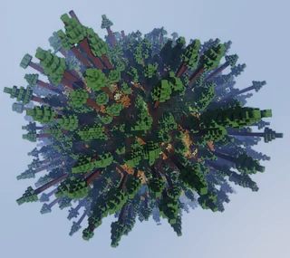
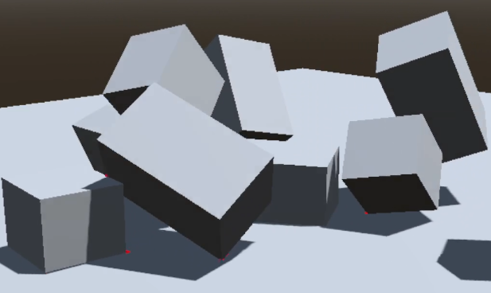
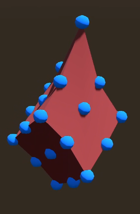
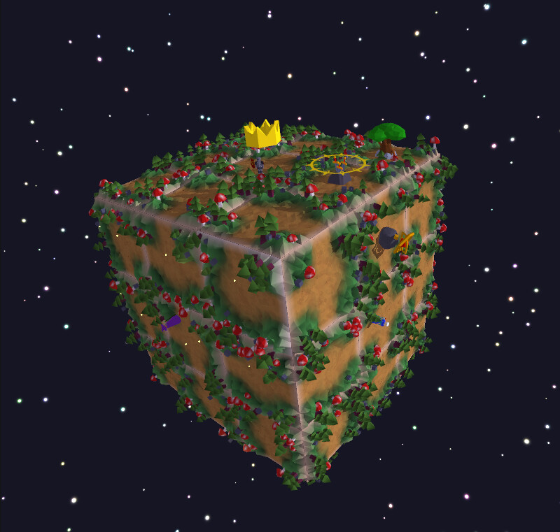
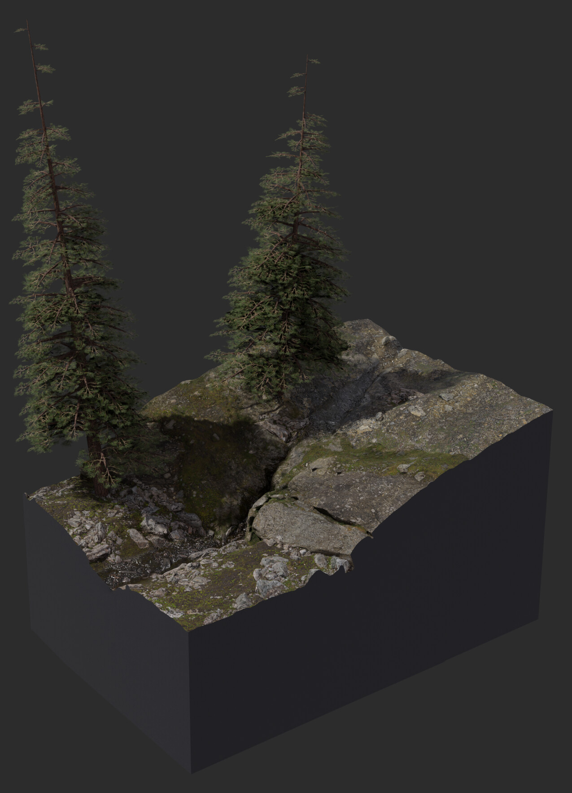
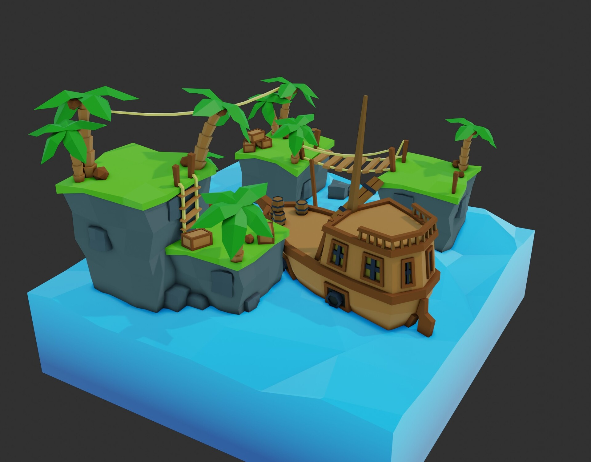
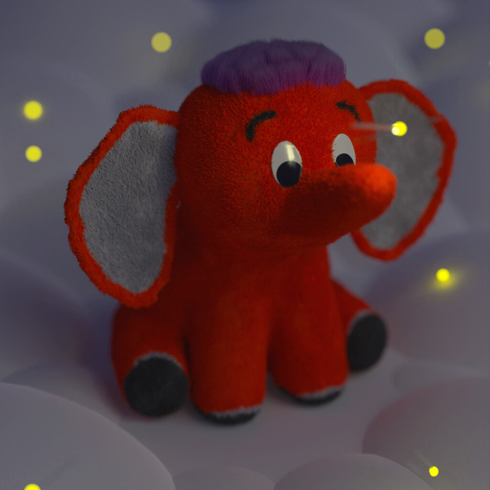
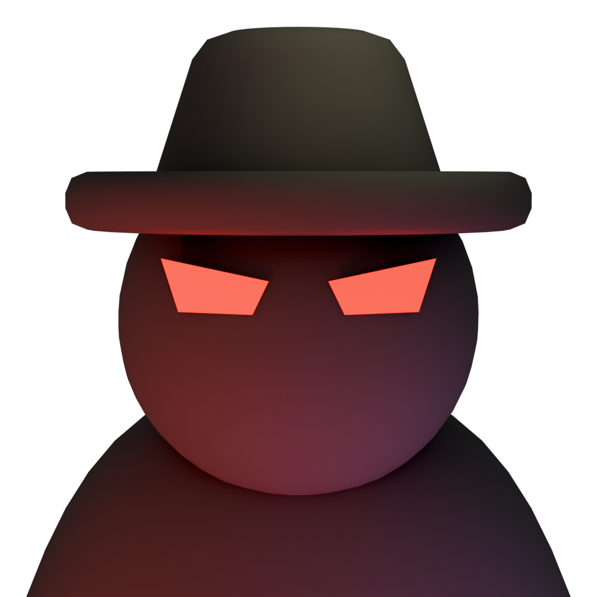
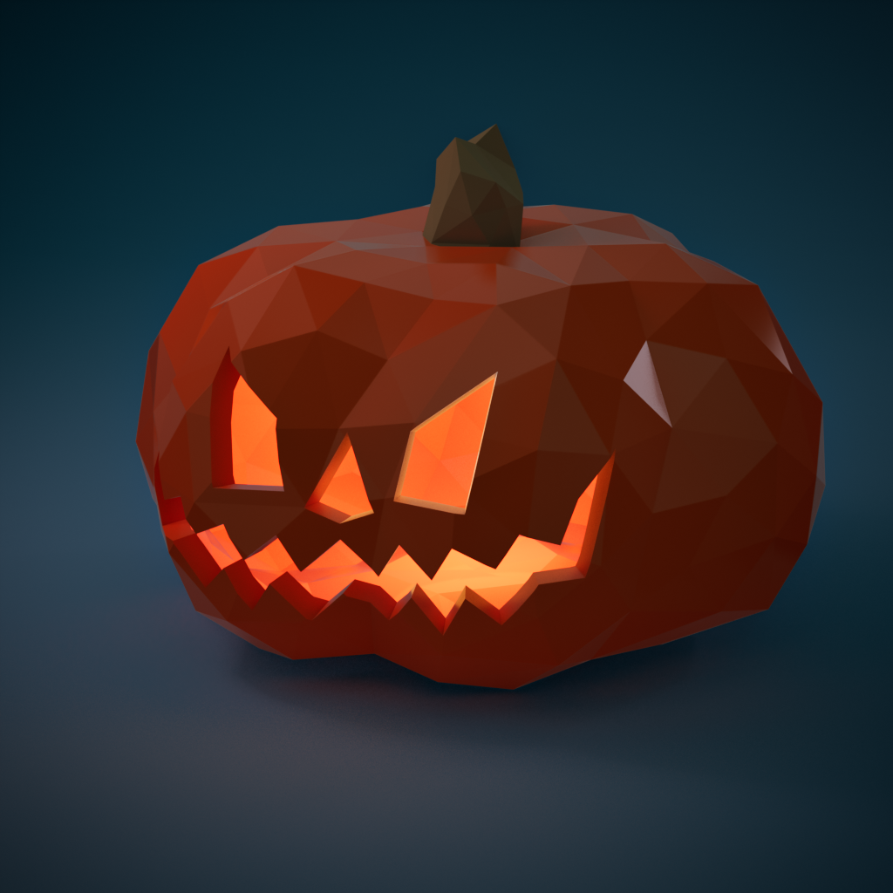
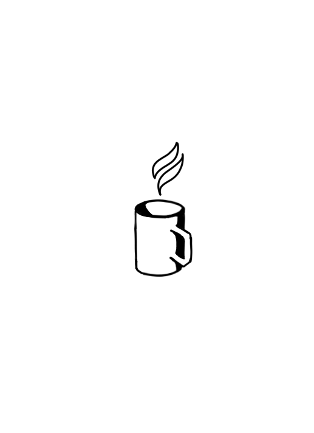

# Hi there, I'm Ilia!

  
  <pre>
  A_,,,_A       - 5th year MIPT student & MSc student at UU   
 ((O)V(O))      - (Ex) 1C company software engineer           
(w\W|W|W/w)     - Huge computer graphics & game dev nerd      
 \v|W|W|v/      - Contributor to Charm Quark Engine           
   "|v|"        - Fan of the "f*ck around and find out" method
    ^ ^                                                       
  </pre>

---

### FleCSibleLua

My GitHub profile is something of a scrapyard of various projects, **[FleCSibleLua](https://github.com/Sigmarik/FleCSibleLUA)** being the most "finished" of them all.

It is a framework that bridges Lua with the Flecs ECS, featuring:
- A **custom interpreter** for deeper integration
- **Compile-time parser generation** because I don't like `flex` and `antlr` quite enough to let them into my project
- **Enhanced Lua syntax** to make it as expressive as possible for game development

Think of it as my attempt to imagine what Lua could have looked like if it was specifically tailored for game development.

---

### The Rest of the Projects

Beyond that, my GitHub is more of a digital dumpster that is sometimes on fire.\
It primarily consists of:

- **Game engines & games**
- **Shaders & visual demos**
- **Minecraft & other game mods**
- **Some deeply technical (and possibly boring) experiments**

Almost none of them have overly descriptive READMEs, but hey, the code is here if you want to take a look.

---

### Let's Chat!

I'm always excited to collaborate, discuss interesting ideas, or just nerd out about game tech.

Feel free to send me a message via
- Email: itkudryashov@gmail.com
- Telegram: https://t.me/GrumpyUvut
- Linked In: https://www.linkedin.com/in/grumpy-uvut/

---

### Gallery

\

***Foggy Fjords**, an unreal engine graphics demo*\
*No external assets, no help, just sweat, blood and pixels*

 

*Vulkan demos*

 

\
*Sildur's Vibrant Shaders fork with curvature*

 

\

*Spell brewing minecraft mod where ingredients are interpreted as processor instructions.*

 

*XPBD physics engine*

 

\

*Random demos made with everything from OpenGL to Blender, Krita, Unreal and Unity*

  
  <em>Thanks for stopping by! Have an awesome day.</em>

---

*P.S. Yes, the ASCII owl is here to stay.*
